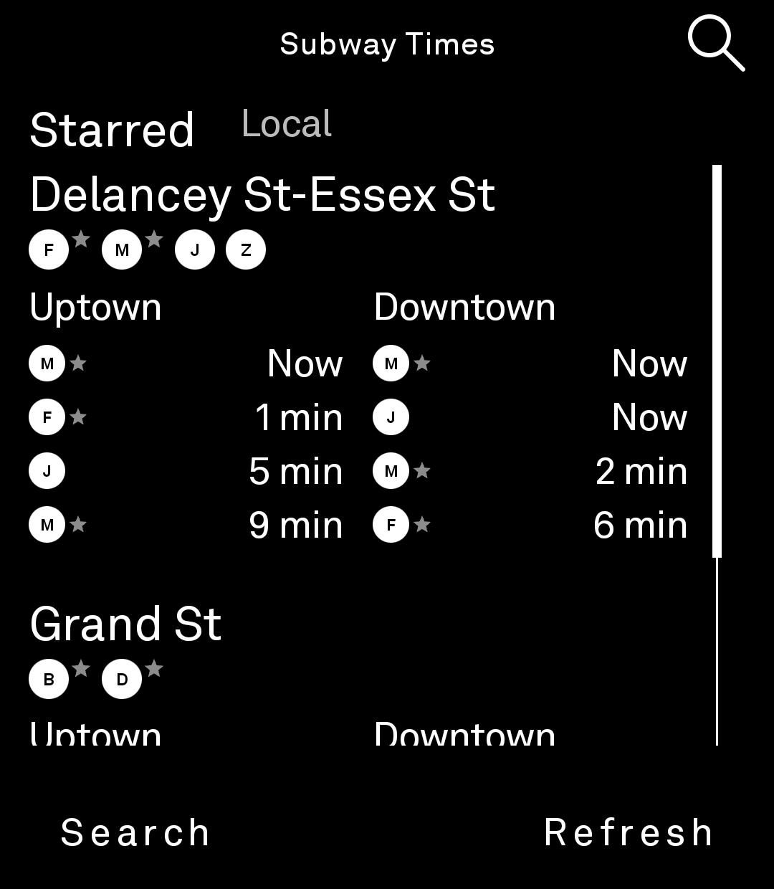
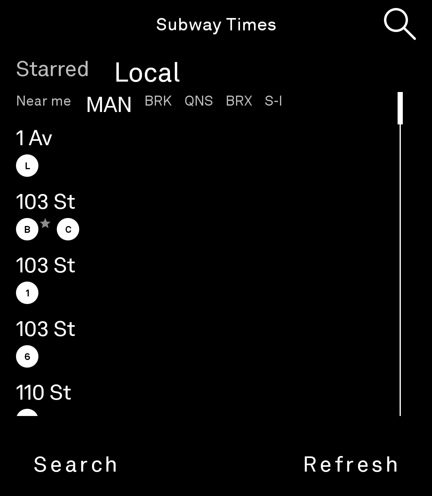

<a href="https://github.com/sponsors/gi-os"></a>


# BrightTransit

[**⬇ Download the latest APK**](https://github.com/gi-os/BrightTransit/releases/latest) · free, open source.

Live subway arrival times for New York City, on the Light Phone III. LightOS shows the
tool as **Subway Times**.

## Install via BrightMarket

<p align="center">
  
</p>

Scan the code above with **BrightMarket** installed to open BrightTransit there and
install or update it directly. Don't have BrightMarket yet? Get it, and browse
every Bright app, at
**[brightmarket.gzl.dev](https://brightmarket.gzl.dev)**.

**Current release: v1.2.0** (tag `v1.2.0-build.21`). `versionCode` 3, tool id
`com.thelightphone.lightnycsubway`.

Part of the [Bright* collection](https://brightmarket.gzl.dev).

## What it does

- **Home** is the stations you saved, each with the next trains in both directions. Nothing else.
- **Directions use real names.** The L at Morgan Av says "Manhattan" and "Brooklyn", not "Uptown" and "Downtown". Where the MTA only gives a compass word, the direction is named after where the train is going, and every train on a station page shows its last stop, read from the live feed. A train that is turning back early says so.
- **Service alerts.** A station page shows the MTA's alerts that are in effect right now: delays on its lines, a suspension anywhere along them, and work or notices at that station. On Home a station with something wrong gets one line saying what.
- **Search forgives.** Words match in any order, spelled out or abbreviated ("14th Street Union Square"), with a typo or two, and by the names people actually use ("Myrtle Broadway", "Port Authority", "Citi Field"). Search opens straight on the keyboard.
- **Nearby** (the pin) lists the closest stations and shows the trains at the nearest one.
- **Times keep themselves current.** They count down on their own and are fetched again every 30 seconds while the screen is showing. If the signal drops, the last times stay up and are marked as not live.
- **Favorite lines.** Tap a line on a station page to favorite it. It gets a small star, and its trains come first on that station's page and on Home.
- **Trains are grouped by where they go**, not by the feed's north and south. At Delancey St-Essex St the F and the J to Brooklyn are listed together.
- **Follow a train.** Tap a train on a station's page to see every stop it has left and when it gets to each. Tap your stop, and the screen counts the stops down to it in large type: "5 stops to 14 St-Union Sq", then "Next", then "Now". If the tool is closed in the middle of a ride it opens on the ride again.
- **Direct trains.** Search from a station's page, and the station you open says which train runs to it from the one you searched from, when it leaves there and when it arrives. Tap it for every direct train, and tap a train to count down to your stop.
- **Trips with one change.** Where no train runs direct, or a change gets you there at least five minutes sooner, it also offers a way with one change: "Change at 14 St-Union Sq to the 4 or 5", how long you have to change, and when you arrive. A change is only offered inside one station, through a transfer the MTA lists, with the MTA's own time to walk it and four minutes to spare, and only when the first train is a real, moving train. On a recording of every train one Thursday afternoon, a change offered with two moving trains held as named 98.4% of the time, as often as a direct train is caught. Tap it to count down to the change. When you get there, NEXT TRAIN shows the live trains from there.

Following a train only works while the tool is open and the screen is lit. Light's SDK gives a tool no notifications, vibration or background work, so it cannot tell you when to get up: it is right when you look at it. With no signal the count turns grey, is worked out from the train's last times, and says how old they are. A grey count never rises while there is no signal. When the signal comes back it can be put right by a stop, rarely two. After five minutes with no signal it stops counting and says so.

One row of buttons along the bottom of every screen: nearby, search, refresh.

The same code ships to the Light Tool Library as
[BrightNYCSubway Lite](https://github.com/gi-os/BrightNYCSubwayLite), built with nothing but
Light's official SDK. The two have the same features; this one is the sideloaded build.

## The wheel

Turning the phone's wheel scrolls the board, the station page and the search results. A
search for "st" returns most of the system, so that last one is the reason it is here.

Nothing else has to be installed for it. Light patched
`/system/usr/keylayout/Generic.kl`, so a notch is an ordinary key event that lands in
whichever app holds focus, and this tool reads it itself. No companion service, no
permission, no root.

A light-sdk tool has no activity of its own to override, but the SDK hands every key that
is not Back or Home to the screen on top of the back stack before it forwards anything to
LightOS. So each of the three screens claims the two wheel scancodes — LightOS relabels
them `WHEEL_CCW` and `WHEEL_CW` — in `onKeyDown` and `onKeyUp`, and the notch reaches the
scroll view through a flow rather than through the screen reaching into its own UI.
Claiming both halves of the notch is what stops the turn carrying on to the server as a
brightness change. Notches arrive faster than a frame, so each one becomes a debt that a
share of gets paid off per frame, and the first notch after a pause is held back, because
the wheel sits under a thumb.

The wheel *click* and the camera button are left alone. Those belong to
[BrightControl](https://github.com/gi-os/BrightControl), which is optional and owns them
across the phone: hold the wheel in and turn for brightness, tap it for the flashlight,
press the camera button for the camera. Each is rebindable, tap and hold separately, to any
installed app, and apps that handle no wheel keys of their own get brightness or a
synthetic-swipe scroll out of it. The long version is in
[LightNews](https://github.com/gi-os/LightNews#the-wheel-and-the-camera-button).

Installing it changes nothing in here, deliberately. The tool ships as
`com.thelightphone.lightnycsubway`, and BrightControl treats every `com.thelightphone.` id
as hands-off, because a key an SDK tool does not claim is forwarded to LightOS, which
already does the sensible thing with it — a bare turn becomes brightness. A service in the
middle would be taking that away rather than adding anything. The trade is that
BrightControl's button bindings do not reach this tool: the click and the camera button keep
whatever LightOS does with them. Scrolling is unaffected either way, which is the part that
matters here.

If you want BrightControl for the rest of the phone:

```bash
# Optional: BrightControl, for brightness, the flashlight and the camera button
adb install -r LightControl-v1.0.x.apk

# The key service. NOTE: this setting is a list, and this command REPLACES it —
# if you also run LightVoice's push-to-talk, colon-join both components instead.
adb shell settings put secure enabled_accessibility_services \
  com.gios.lightcontrol/com.gios.lightcontrol.keys.ControlService
adb shell settings put secure accessibility_enabled 1

# Brightness, and the level readout + opening apps from the service
adb shell appops set com.gios.lightcontrol WRITE_SETTINGS allow
adb shell appops set com.gios.lightcontrol SYSTEM_ALERT_WINDOW allow
```

The current build is at
[BrightControl/releases/latest](https://github.com/gi-os/BrightControl/releases/latest).

## How it stays fast

The station file parses once and is kept for as long as the tool runs. Every screen shares
one cache of the MTA's feeds: a feed fetched in the last 20 seconds is not fetched again, and
a station asks only for the feeds its lines are in, all at once. A feed that fails leaves the
last good copy on screen, marked as not live, and never empties the board. Ways there,
with or without a change, are worked out off the main thread.

## Layout of this repository

This is the [light-sdk](https://github.com/lightphone/light-sdk) tree with one tool
added. Upstream code stays where upstream put it, which keeps a rebase cheap.

| Path | What it is |
| --- | --- |
| `examples/LightNYCSubway/` | The tool |
| `examples/LightNYCSubway/src/main/kotlin/com/thelightphone/subway/data/` | Feeds, the GTFS-realtime reader, stations, alerts, following a train, the planner |
| `examples/LightNYCSubway/src/main/kotlin/com/thelightphone/subway/*Screen.kt` | Home, station, search, nearby, train, ride and direct-train screens |
| `examples/LightNYCSubway/src/main/kotlin/com/thelightphone/subway/ui/` | Shared UI and every sentence the rider reads |
| `examples/LightNYCSubway/src/main/kotlin/com/thelightphone/subway/hw/` | Wheel keys and the notch-to-scroller bus |
| `examples/LightNYCSubway/src/main/assets/stations.json` | Station catalog, with the MTA's times to change trains |
| `examples/LightNYCSubway/scripts/` | Builds the station file; captures and checks test fixtures |
| `examples/LightNYCSubway/lighttool.toml` | Tool identity, version and permissions |
| `sdk/`, `plugin/`, `builder/`, `docs/`, other `examples/` | Upstream light-sdk |

## Build

```sh
./gradlew :examples:LightNYCSubway:assembleDebug
```

You need JDK 17 and the Android SDK. The SDK client libraries come from GitHub Packages,
so set a token with package-read access first:

```sh
export GITHUB_ACTOR=<your-username>
export GITHUB_TOKEN=<token-with-read:packages>
```

You can put `gpr.user` and `gpr.key` in `local.properties` instead. Never commit either
one.

`.github/workflows/build-apk.yml` builds the tool on each push to `main` that touches
`examples/BrightTransit/`, and attaches the APK to a GitHub Release.

## Run it

To run against the LightOS emulator, set `serverPackage = "com.thelightphone.sdk.emulator"`
in `examples/BrightTransit/lighttool.toml`. Set it back to `com.lightos` before a device
build. The SDK [system-app guide](docs/system_app/README.md) covers the one-time emulator
setup.

## Screenshots

<table>
  <tr>
    <td align="center">
      <br>
      <sub>Starred stations, live arrivals</sub>
    </td>
    <td align="center">
      <br>
      <sub>Browse by borough</sub>
    </td>
  </tr>
</table>

Taken on a Light Phone III against the live MTA feeds.

## Origin and credits

- **[lightphone/light-sdk](https://github.com/lightphone/light-sdk)** is the base of
  this repository. The whole tree is a fork. The Light Phone team wrote the SDK client,
  the Gradle plugin, the lint rules, the builder and the emulator, and released all of
  it under MIT before the platform was even public. Thank you.
- **[MTA](https://api.mta.info/)** publishes the GTFS-realtime feeds and the station
  data as open data. The station catalog derives from it.
- **[Ktor](https://github.com/ktorio/ktor)** and
  **[OkHttp](https://github.com/square/okhttp)** move the bytes. A hand-rolled decoder
  reads the protobuf, so the tool stays inside the SDK dependency allowlist.
- The Light Phone, LightOS and Light Phone III are names of The Light Phone. This is an
  unofficial community tool.

This repo set the pattern the rest of the collection reuses. Fork light-sdk, write the
tool into a module the SDK reserves for it, leave upstream alone, and let a GitHub
Actions workflow build the APK. [BrightNews](https://github.com/gi-os/BrightNews) and
[BrightSolitaire](https://github.com/gi-os/BrightSolitaire) both follow it.


## Version history

CI (`.github/workflows/build-apk.yml`) builds and releases automatically on every push to `main`
that touches `examples/BrightTransit/` or the workflow file itself. The tag is
`v<versionName>-build.<run number>`, with `versionName` read from `lighttool.toml` — a push that
only edits docs elsewhere in the repo does not cut a release.

- **v2.0.0** (2026-11-12) — Rewritten after feedback from Light. Home is only your saved
  stations; one bottom row everywhere (nearby, search, refresh); "Save" replaces "Star". Trains are
  grouped by where they go ("Manhattan", not "Uptown", for the L) and each shows its last stop from
  the live feed. Search matches words in any order, abbreviations, typos and nicknames, and opens
  on the keyboard. Times count down and refresh on their own, and stay up marked "not live" when
  the signal drops. Location comes from LightOS; the IP lookup is gone, so the app talks only to
  the MTA. Saved stations and favorite lines carry over, including ones saved under old ids.
  Built on Light SDK 0.2.0, which no longer needs a GitHub Packages token. Also new in 2.0.0:
  the MTA's service alerts at each station; follow a train and count down the stops to yours;
  direct trains between two stations; and trips with one change, inside one station, timed
  with the MTA's own transfer times.
- **v1.2.0** (build 21, 2026-07-29) — Hardware wheel scrolls the board, the station list and search
  results, with a bump guard against stray brushes (`ArmedNotches`).
- **v1.1.0** (builds 10–19, 2026-07-28) — Local tab: browse stations by borough, or by GPS/IP-based
  distance under **Near me**; favorite lines and stations; real subway route bullets; adaptive
  launcher icon; SDK icons on the bottom bar in place of text.
- **v1.0.0** (builds 3–8, 2026-07-27) — Initial release: live GTFS-realtime arrivals over direct MTA
  feeds, stations merged by MTA Complex ID, Uptown/Downtown columns, renamed from `nyc-subway` to
  BrightTransit / "Subway Times".

## License

MIT, the same as upstream light-sdk. See [LICENSE](LICENSE).

<!-- bright-footer:begin -->
---

## Bright\*

**It's not Light, it's Bright.**

26 open-source apps for the **Light Phone III** — camera, music, maps, messages,
reading, transit, games. The phone has no app store, so they install by sideload: scan one
code from **[brightmarket.gzl.dev](https://brightmarket.gzl.dev)** and BrightMarket keeps them updated.

[Roll](https://github.com/gi-os/Roll) · [BrightNotebook](https://github.com/gi-os/BrightNotebook) · [BrightControl](https://github.com/gi-os/BrightControl) · [BrightWay](https://github.com/gi-os/BrightWay) · [BrightChat](https://github.com/gi-os/BrightChat) · [browse all 26 →](https://brightmarket.gzl.dev)

The Light Phone does not sponsor or endorse any of these. Built by
[Giovanni Lupo](https://github.com/gi-os) — if this one is useful to you, a ⭐ helps the next
person find it.
<!-- bright-footer:end -->

## Support

These apps are free, open, and built on my own time. Sponsorship pays the bills that don't go away: build servers, test hardware, and the crash reporter that keeps them shipping. Donation or not my code is always free for the world to use.

[Sponsor on GitHub](https://github.com/sponsors/gi-os)
